# Ölçüm Kartı (Measurement Board)

**A bench measuring instrument you can build yourself and use from your phone and your PC.**
Voltmeter · ammeter · wattmeter · energy counter · oscilloscope · battery capacity tester — in one box.

<p align="center">
  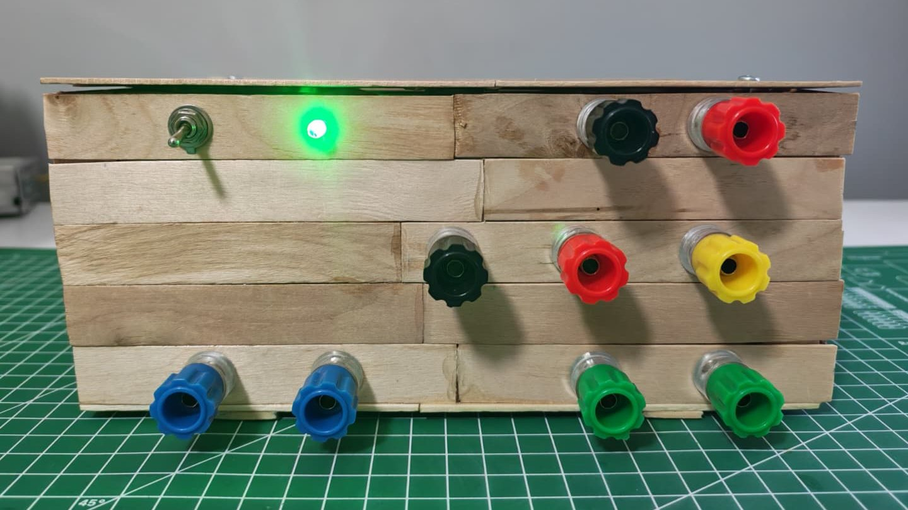
</p>

<p align="center">
  <a href="README.md">Türkçe</a> ·
  <a href="#build-your-own">Build your own</a> ·
  <a href="#apps">Apps</a> ·
  <a href="#quick-start">Quick start</a> ·
  <a href="GELISTIRICI.md">Developer notes</a> ·
  <a href="LICENSE">MIT licence</a>
</p>

The box has no screen. You see the readings over Wi-Fi or USB **in the PC app, in the Android
app or straight in a browser**. The board also logs what it measures to its own memory: recording
carries on while your phone or PC is off, and syncs by itself later.

---

## What it does

| | Range | In short |
|---|---|---|
| ⚡ **Voltage** | ±32 V · ±614 V on the high-voltage input | ~500 readings per second, ~1 mV resolution |
| 🔌 **Current** | ±9.5 A | bidirectional, 5 mΩ shunt |
| 💡 **Power and energy** | V × I on every sample | signed power (it sees back-feeding too), Wh counter |
| 📈 **Oscilloscope** | −63 … +47 V | up to 83 000 samples per second; frequency, duty cycle, Vpp and rise time measured automatically; single-shot trigger, FFT |
| 🔋 **Battery capacity test** | batteries up to 38 V | mAh and Wh, discharge curve, cut-off voltage, open-circuit voltage, optional internal resistance |
| 💾 **Recording** | ~11 MB inside the board | even if the power fails, the recording up to that moment is kept; name, tags and notes per recording |

**Live** — voltage, current, power and energy on one screen; the chart window and the refresh rate can be chosen.

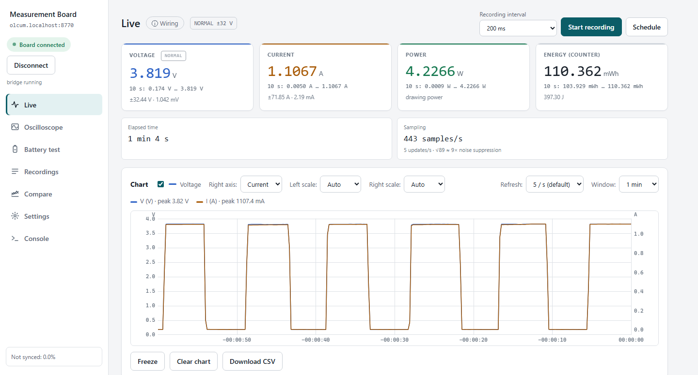

<sub><b>A real measurement:</b> an 18650 cell connected to a 3.3 Ω resistor and disconnected again — 3.10 V · 0.875 A · 2.72 W. Blue is voltage, orange is current.</sub>

**Oscilloscope** — shows the waveform and measures the frequency, duty cycle and edge times by itself.

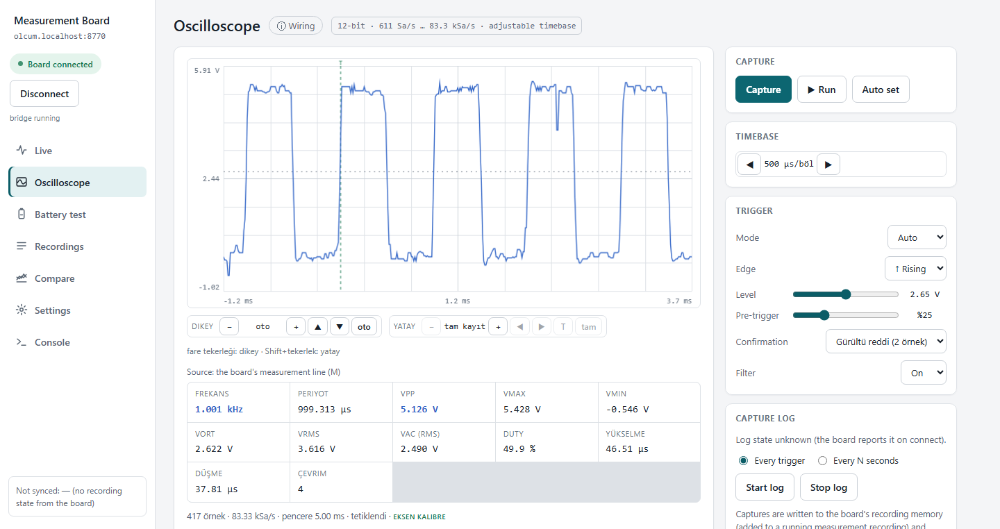

<sub><b>A real capture:</b> a 1 kHz / 5 V square wave generated by an Arduino. Measured by the board: 1.001 kHz, 49.9 % duty cycle, 10 µs rise time.</sub>

**Battery test** — you enter the cut-off voltage; the board discharges the battery and disconnects the load
by itself when it reaches that voltage. The load stays off for the first 5 seconds, so the open-circuit
voltage (OCV) shows up separately on the chart.

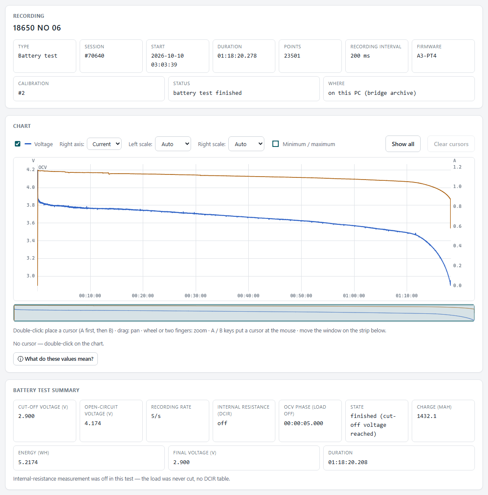

<sub><b>A real measurement:</b> one 18650 cell, 3.3 Ω load (~1.1 A), 2.9 V cut-off → <b>1432 mAh · 5.22 Wh</b> in 1 hour 18 minutes. Blue is voltage, orange is current; the short section at the very start is the OCV.</sub>

---

## Apps

The same panel runs in three places: the board's own web page, the **PC app** and the **Android app**.
It has three looks — dark, light and front panel — and comes in Turkish and English.

### 💻 PC app (Windows)

- Finds the board **over USB or Wi-Fi** by itself; the panel opens at `http://olcum.localhost:8770`.
- **Archives the board's recordings on the PC** (every 2 minutes); search, names, tags, trash.
- **Compares** recordings (up to 6 on the same chart) and exports them as CSV and as a report.
- Opens no console window; it sits as an icon in the notification area and can, if you want, show the board's notifications (MQTT) as Windows notifications.

**Compare** — real tests of two 18650 cells on the same chart (1366 mAh and 1432 mAh).

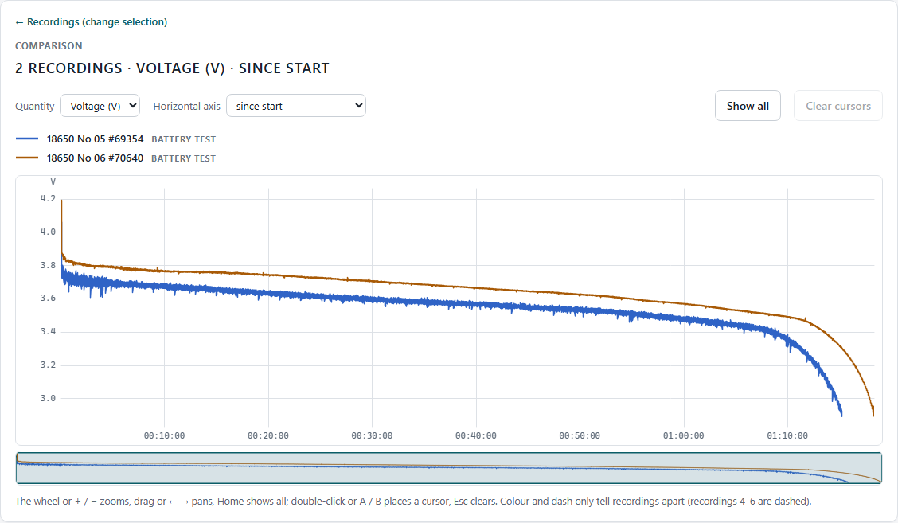

**ⓘ Wiring** — an illustrated “which lead goes into which jack” window on every screen.

<p align="center">
  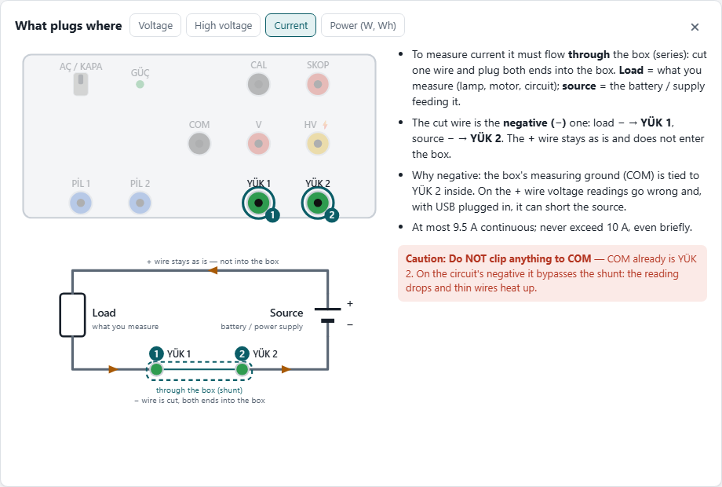
</p>

### 📱 Android app

The same panel as on the PC, on your phone: Live, Oscilloscope, Battery test, Recordings and Compare.
A copy of the recordings stays on the phone; you can send files with **Share** and **print** the report.
The phone and the board must be on the same Wi-Fi network (the phone's own hotspot works too).

<table>
  <tr>
    <td width="33%">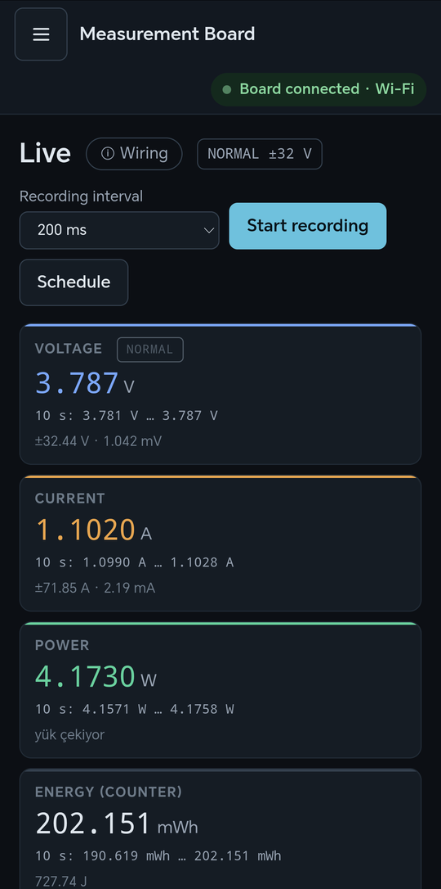</td>
    <td width="33%">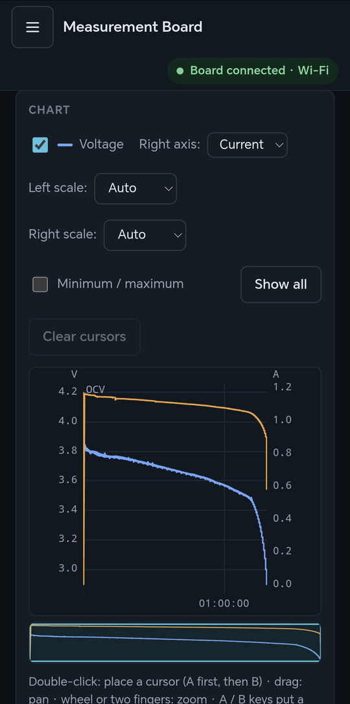</td>
    <td width="33%">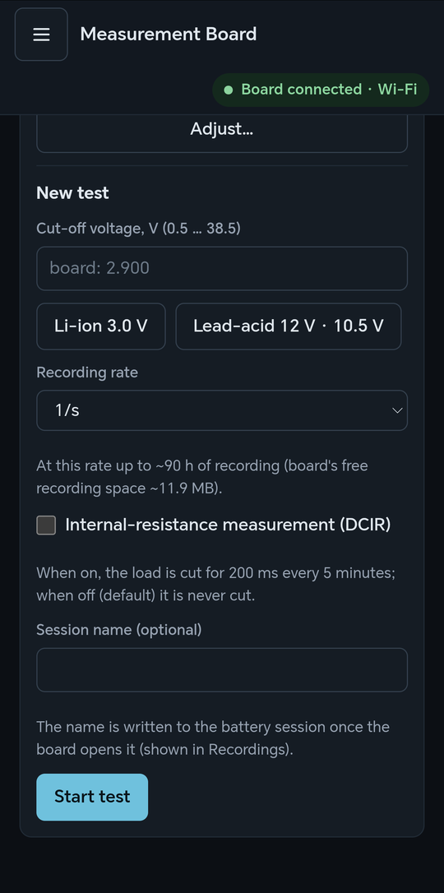</td>
  </tr>
  <tr>
    <td align="center">Live</td>
    <td align="center">Battery test recording</td>
    <td align="center">New battery test</td>
  </tr>
</table>

---

## Build your own

This project has **no PCB**: the main board is hand-built on perfboard and the box is made from wooden sticks.
Every step is explained **with drawings** in the HTML guides in the [`BELGELER/en/`](BELGELER/en) folder.

> **To open the guides:** download the repository (**Code → Download ZIP**) and open
> `BELGELER/en/index.html` in a browser. GitHub only shows these pages as source code.

| Guide | What's inside |
|---|---|
| [What it can do](BELGELER/en/1-ne-yapabilir.html) | every capability and range |
| [Parts](BELGELER/en/2-malzemeler.html) | every part you need |
| **[Layout](BELGELER/en/7-yerlesim.html)** | **assembly starts here**: soldering the perfboard step by step, which part goes into which hole; a check measurement at the end of every step |
| **[Enclosure](BELGELER/en/8-kutu.html)** | the box, the panel holes, the wiring — every step with a 3D view |
| [Battery test](BELGELER/en/3-pil-testi.html) | how to connect a battery, how to read the result |
| [Connecting](BELGELER/en/6-ag.html) | USB, the board's own Wi-Fi, your home network |
| [PC app](BELGELER/en/9-pc-uygulamasi.html) | installation, pairing, archive, notifications |
| [Schematic (PDF)](BELGELER/sema.pdf) | the complete circuit |

**Layout guide** — in every sub-step only that step's parts are highlighted; underneath, a table says which leg goes into which hole.

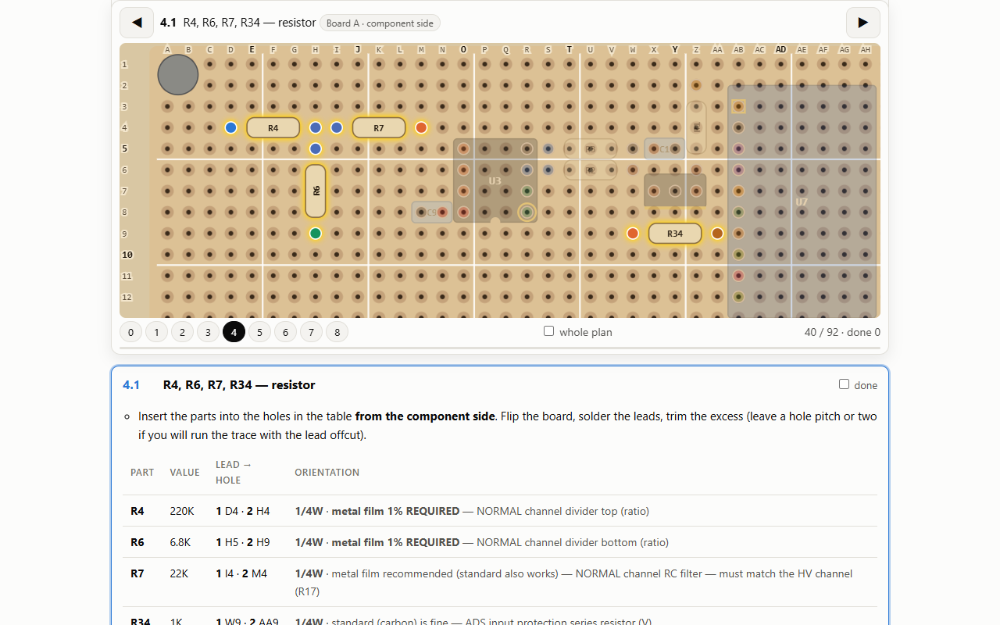

**Enclosure guide** — every step shows in 3D what has been built up to that point; you can rotate it and hover over a part to see its dimensions.

<table>
  <tr>
    <td width="50%">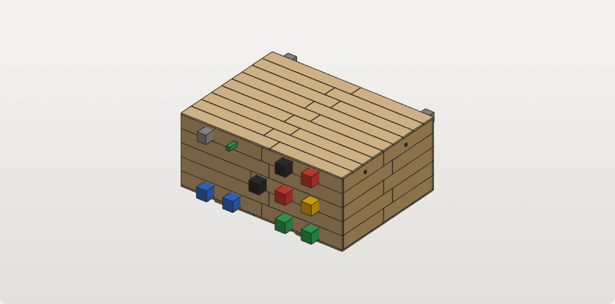</td>
    <td width="50%">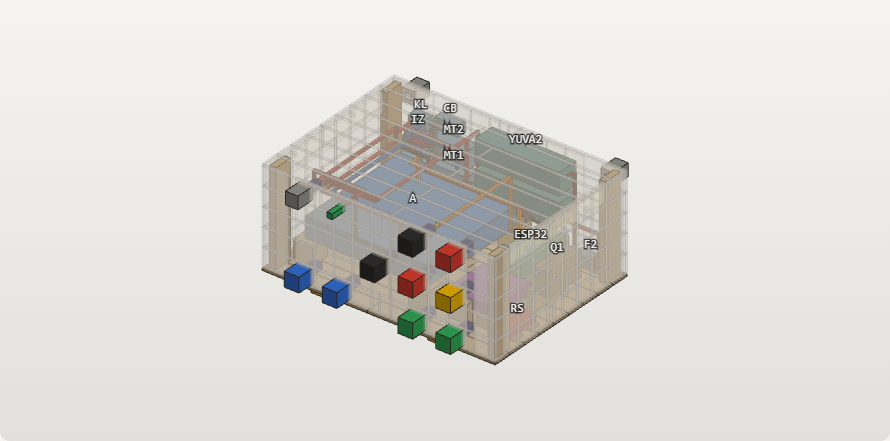</td>
  </tr>
  <tr>
    <td align="center">Finished box</td>
    <td align="center">Transparent walls: the inside and the wiring</td>
  </tr>
</table>

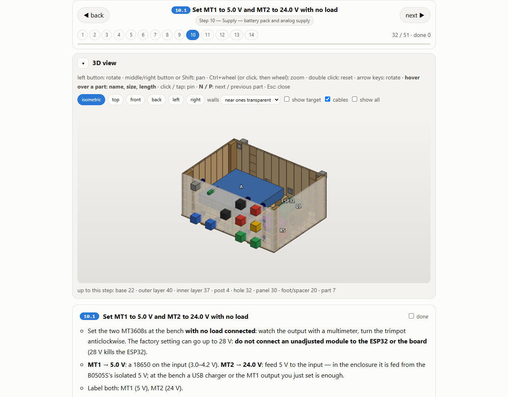

**What it looks like for real:**

<table>
  <tr>
    <td width="41%">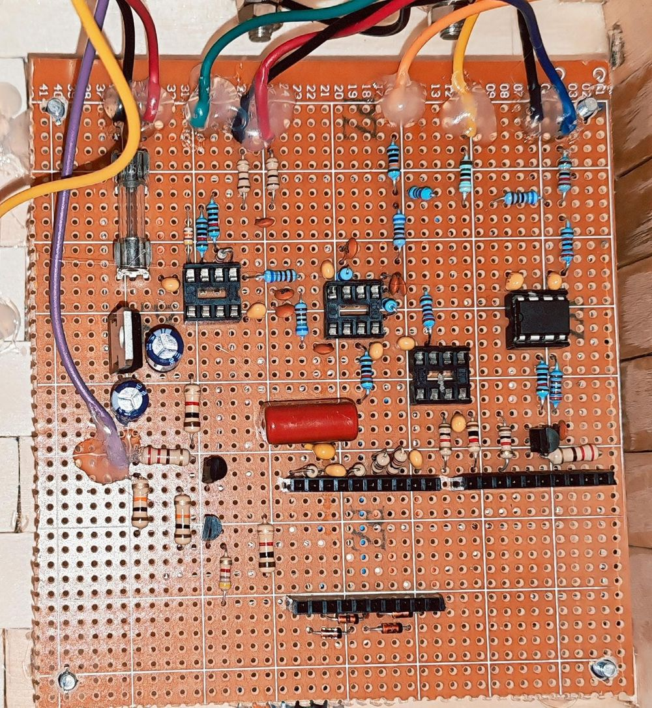</td>
    <td width="59%">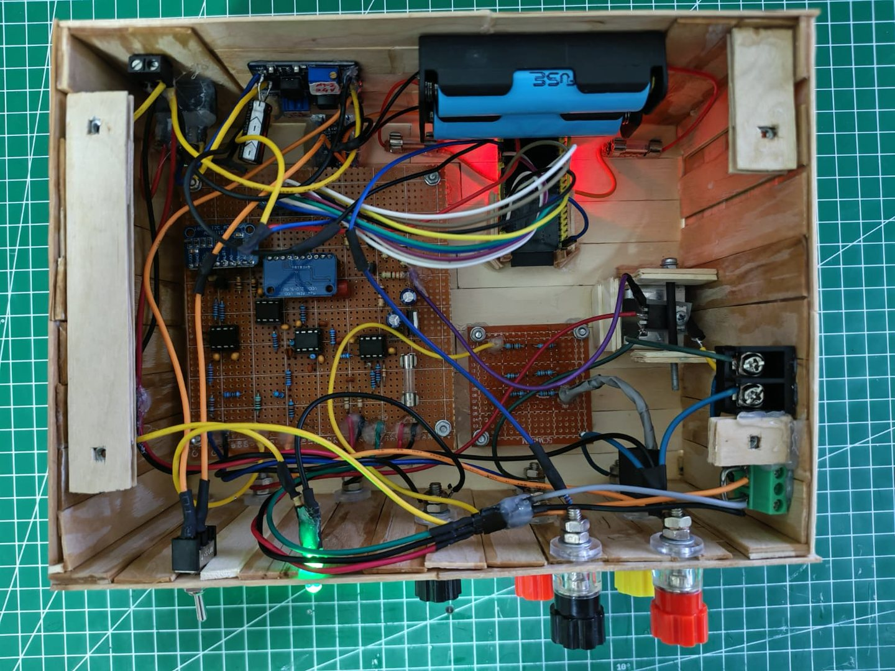</td>
  </tr>
  <tr>
    <td align="center">Main board (perfboard)</td>
    <td align="center">Inside the box, lid open</td>
  </tr>
</table>

---

## How it works inside

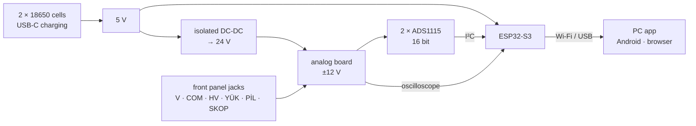

<sub>The jack labels on the box are Turkish: YÜK = load, PİL = battery, SKOP = scope.</sub>

- The box runs on **its own batteries**. The analog side is fed from an isolated converter, so the measurement
  circuit is not disturbed even while the charging cable is plugged in.
- Two ADS1115s read the voltage and the current **at the same moment**; the ESP32-S3 computes power, energy and
  capacity on every sample.
- The oscilloscope uses the ESP32's own fast ADC.
- One ESP32 core only measures, the other runs Wi-Fi and the web work; web traffic never holds up the measurement.

---

## Quick start

1. **Parts and assembly** — the guides above: first [Layout](BELGELER/en/7-yerlesim.html), then [Enclosure](BELGELER/en/8-kutu.html).
2. **Flash the firmware** (board: ESP32-S3 **N16R8**, the board's USB socket marked `COM`):
   ```
   cd uretim
   python yukle.py                                  # build + upload
   python arayuz-uret.py && python arayuz-yaz.py    # write the panel into the board's flash
   ```
   You need `arduino-cli` and the ESP32 core; the Arduino IDE settings are in [GELISTIRICI.md](GELISTIRICI.md).
3. **Introduce it to your home Wi-Fi** — open the serial console at 115200 baud and type `Na<network name>`, then
   `Np<Wi-Fi password>`. The board remembers up to 8 networks; later you add and select them in the panel under
   **Settings → Network**. If no known network is around, the board opens its own network (`OLCUM-KARTI-xxxx`,
   address `192.168.4.1`). Details: [Connecting](BELGELER/en/6-ag.html).
4. **Set the web password** — `Ns<password>` on the serial console (at least 12 characters). This password protects
   the board's commands and is separate from the Wi-Fi password. Until it is set, anyone on your network can send
   commands to the board.
5. **PC app** — with Python 3 installed, double-click `kopru\PC Baslat.bat`. To pair the PC with the board once
   and to get a desktop shortcut: [PC app guide](BELGELER/en/9-pc-uygulamasi.html).
6. **Android app** — no ready-made APK is published yet; it is built from the `mobil/` folder (Node.js, JDK 17, Android SDK):
   ```
   cd mobil
   npm install
   npm run esitle
   npm run apk        # → android/app/build/outputs/apk/debug/app-debug.apk
   ```
   The app finds the board on the same network; on the **Pair with the board** screen you enter the web password
   once (it is not stored on the phone).

---

## Safety

- **Do not connect it to mains (220 V).** The board is not isolated; only measure circuits powered by batteries
  and DC-DC converters.
- High voltage is measured only on the **HV** jack; while measuring HV, do not plug the USB cable into a computer.
- When measuring current, **do not clip anything to COM**: inside, COM is connected to YÜK 2 (load 2), so the shunt
  would be bypassed.
- Current: **9.5 A** continuous at most; never go above **10 A**, not even briefly.
- In a battery test the battery's plus **does not go straight to a PİL jack**: it goes through the load resistor
  to PİL 1. Do not connect the battery backwards — the board cannot cut that off.
- Details: the **ⓘ Wiring** window on every screen and the usage rules in the [Enclosure guide](BELGELER/en/8-kutu.html).

---

## For developers

Every design claim is checked by a runnable test: circuit simulation (ngspice), schematic checks (KiCad), the
firmware's measurement math in an AVR emulator, and tests for the panel, the PC bridge and the Android app.
Whether the tests really catch faults is measured with **mutation testing**: the source is broken in a copy and
the test must turn red.

```
cd uretim
python dogrula3.py --tam     # the whole verification chain
python mutasyon.py           # do the tests catch broken code?
```

| Folder | What's inside |
|---|---|
| `kod/olcum-karti-a3/` | firmware (ESP32-S3, Arduino) |
| `arayuz3/` · `ortak/` | web panel and shared JS modules |
| `kopru/` | PC app (Python standard library only) |
| `mobil/` | Android app (Capacitor) |
| `sema3/` | KiCad schematic |
| `BELGELER/` | user guides (Turkish; English in `BELGELER/en/`) — generated, never edited by hand |
| `uretim/` | verification chain, simulations, document generators |

More: [GELISTIRICI.md](GELISTIRICI.md) (Turkish: [GELISTIRICI.tr.md](GELISTIRICI.tr.md)) · engineering journal
[DEVIR.md](DEVIR.md) (Turkish, long).

---

## Licence

[MIT](LICENSE). No warranty: this is an instrument that can measure high voltage — you are responsible for your own safety.
